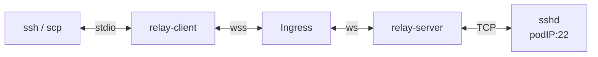
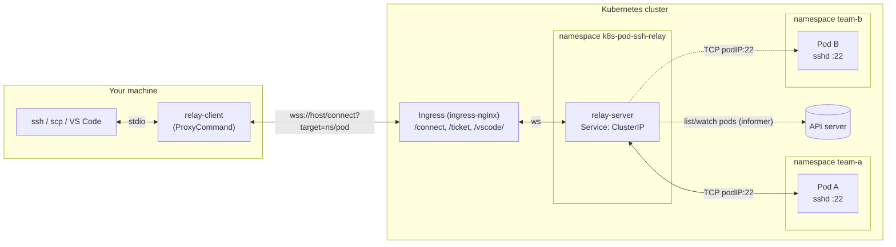
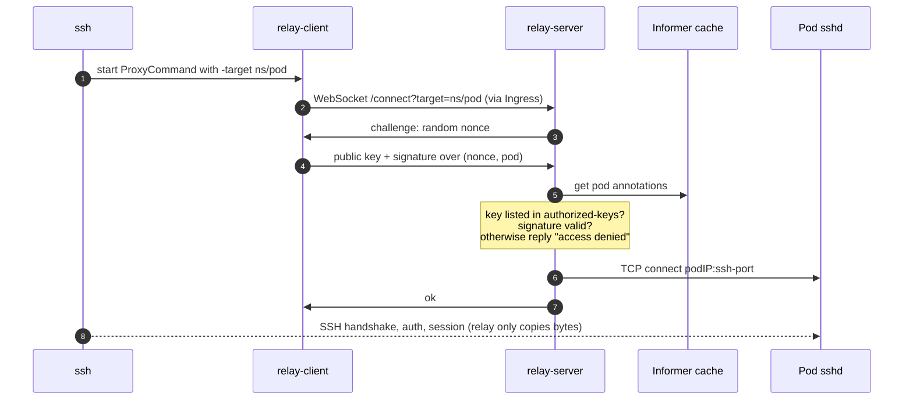

# k8s-pod-ssh-relay

English | [简体中文](README.zh-CN.md)

SSH into Kubernetes pods that run a stock `sshd`, through a WebSocket relay used as the ssh `ProxyCommand`. Target pods expose no Service and no port outside the cluster, and need no agent or sidecar.



## Features

- **Plain ssh**: works with `ssh`, `scp`, `sftp`, `rsync -e ssh`, VS Code Remote-SSH, and port forwarding (`-L` / `-R` / `-D`).
- **Address pods as `namespace/pod`**: `ssh <pod>.<namespace>.relay`. The relay watches pods in all namespaces (or the ones given with `-namespaces`) and resolves names from its informer cache, with no API call per connection.
- **Opt in per pod with annotations**: only pods annotated `k8s-pod-ssh-relay/ssh: "true"` are reachable.
- **SSH key authentication, per pod**: the client proves it holds a key listed in the target pod's `k8s-pod-ssh-relay/authorized-keys` annotation. sshd reads the same annotation, so it is the single source of keys. Changes take effect without restarts.
- **One Ingress entry point**: only `/connect`, `/ticket` and `/vscode/` are exposed. In production, TLS for your domain terminates there (`wss://`, `https://`); the minikube demo uses plain HTTP.
- **VS Code extension, Remote - PodRelay**: open a remote window in a pod from the remote indicator menu, with no extra binaries. See [VS Code](#vs-code-remote---podrelay).

## Architecture



`ssh` and `sshd` talk SSH end to end. The relay authenticates the client, picks the pod, and copies bytes.

### One connection



## How it works

1. `ssh` starts `relay-client` as its `ProxyCommand` and speaks SSH over its stdin/stdout.
2. `relay-client` opens `wss://<host>/connect?target=<namespace>/<pod>` through the Ingress. Where `/` can't be used (ssh host names, VS Code remote authorities), the target is written `<pod>.<namespace>`. Namespaces can't contain dots, so the last dot splits the two.
3. **Authentication.** The relay sends a random 32-byte nonce. The client signs `(nonce, target pod)` with its private key. The relay verifies the signature against the target pod's `authorized-keys` annotation.
   - The nonce prevents replay, and including the pod name binds the signature to that pod.
   - An unknown pod and an unauthorized key both return the same `access denied`, so clients can't probe which pods exist. The relay log records the real reason and the key fingerprint.
4. The relay looks up the pod's IP in its informer cache and dials the pod's sshd directly. From then on it copies bytes in both directions.
5. SSH runs end to end between your `ssh` and the pod's `sshd`, so the relay only ever sees encrypted SSH traffic.

### Pod annotations

| Annotation | Required | Meaning |
|---|---|---|
| `k8s-pod-ssh-relay/ssh` | yes | Must be `"true"` for the pod to be reachable |
| `k8s-pod-ssh-relay/authorized-keys` | yes | Allowed public keys, in `authorized_keys` format, one per line |
| `k8s-pod-ssh-relay/ssh-port` | no | sshd port (default `22`) |

The target image is plain Alpine with OpenSSH. sshd reads `authorized-keys` from a downward API volume through `AuthorizedKeysCommand`. It can't use `AuthorizedKeysFile` because the downward API mount directory has mode `1777`, which sshd's `StrictModes` check rejects.

## Quick start (minikube)

Requirements: minikube, kubectl, Go, OpenSSL.

```bash
minikube addons enable ingress
make all
```

`make all` does the following:
- builds the binaries
- builds the images inside minikube
- generates an SSH key and a session-signing key under `keys/`
- deploys everything to the `k8s-pod-ssh-relay` namespace
- writes an `ssh_config`

```bash
make pods                                # list pods and their annotations
make ssh                                 # log into the first target pod
ssh -F ssh_config <pod>.<namespace>.relay
scp -F ssh_config file <pod>.<namespace>.relay:/tmp/
```

The generated `ssh_config` matches `Host *.relay` and runs:

```bash
relay-client \
  -relay ws://k8s-pod-ssh-relay.test \
  -connect-to <minikube-ip>:80 \
  -i keys/id_ed25519 \
  -target %h
```

To use it without `-F`, add `Include /path/to/ssh_config` at the top of `~/.ssh/config`.

### Grant or revoke access on a live pod

```bash
kubectl -n k8s-pod-ssh-relay annotate --overwrite pod <pod> \
  k8s-pod-ssh-relay/authorized-keys="$(cat keys/id_ed25519.pub ~/.ssh/other.pub)"
```

- The relay picks up the change immediately through the informer.
- sshd picks it up once the kubelet syncs the downward API file, which can take up to about a minute.

### Port forwarding

Forwarding runs as channels inside the SSH connection, so it needs nothing from the relay:

```bash
# local 2224 -> anything the pod can reach
ssh -F ssh_config -N \
  -L 2224:kubernetes.default.svc:443 \
  <pod>.<namespace>.relay

# pod's 127.0.0.1:9000 -> local 3000
ssh -F ssh_config -N \
  -R 9000:127.0.0.1:3000 \
  <pod>.<namespace>.relay

# SOCKS5 proxy egressing from the pod
ssh -F ssh_config -N \
  -D 1080 \
  <pod>.<namespace>.relay
```

### VS Code in the browser

`relay-client web` opens VS Code for the Web in a pod, with nothing to install locally:

```bash
./bin/relay-client web \
  -relay ws://k8s-pod-ssh-relay.test \
  -connect-to $(minikube ip):80 \
  -i keys/id_ed25519 \
  -user demo \
  <namespace>/<pod>
```

1. Over SSH through the relay, it installs the VS Code server's web build in the pod and starts it on port 13337 (`-pod-port`) under `/vscode/<namespace>/<pod>/`. The server is downloaded on your machine (cached, and resumed if interrupted) and uploaded, so the pod needs no internet access.
2. It authenticates to the relay with the same SSH key and gets a ticket valid for 2 minutes, then opens `<relay>/vscode/<namespace>/<pod>/?ticket=…` in the browser (`https://` in production, `http://` in the minikube demo) and exits.
3. The relay swaps the ticket for a 12-hour session cookie scoped to that pod's path, and proxies every request, WebSockets included, to the pod. Only keys listed in the pod's `authorized-keys` annotation can get a ticket, and VS Code's own connection token still applies on top.

The browser must resolve the relay host. For the minikube demo, add `<minikube-ip> k8s-pod-ssh-relay.test` to `/etc/hosts`. Alternatively, `-local` serves VS Code on a local port forwarded over SSH instead of through the Ingress.

## Scaling the relay

The relay keeps no shared state: authentication happens on the connection itself, and each replica runs its own informer. So it scales horizontally (`replicas: 2` by default).

The Ingress hashes on the target pod name (`nginx.ingress.kubernetes.io/upstream-hash-by: "$arg_target"`), so every connection to a given pod goes through the same relay replica. The hashing is consistent: adding or removing a replica only remaps the pods on the replicas that changed, about 1/N of them.

Sessions on a relay replica that stops (rolling update, scale-down, node drain) are disconnected, and the client has to reconnect.

## VS Code: Remote - PodRelay

[`vscode/`](vscode/) contains **Remote - PodRelay**, a VS Code extension that opens a remote window inside a pod, like Remote - SSH. You can open folders, use terminals, debug, and run extensions in the pod.

- **Self-contained**: no `relay-client` or `ssh` binary is needed. The relay protocol and SSH are implemented in TypeScript inside the extension.
- **Tunnel-style connections**: like Remote - Tunnels, it resolves to a `ManagedResolvedAuthority`. Each VS Code connection is an SSH `direct-tcpip` channel to the VS Code server in the pod, and no local port is opened.
- **No internet needed in the pod**: the VS Code server matching your editor's commit is downloaded on your machine (and cached), then uploaded over SSH. glibc and musl pods on x64 and arm64 are supported.
- **Reconnects** after the relay or network drops, and the remote extension host keeps its state.

### Install

```bash
# build vscode/remote-podrelay-0.1.0.vsix
make vscode
code --install-extension vscode/remote-podrelay-0.1.0.vsix

# print the settings for the demo cluster
make vscode-settings
```

1. The extension uses the `resolvers` proposed API, so VS Code must allow it. Run **Preferences: Configure Runtime Arguments**, add `"enable-proposed-api": ["fqix.remote-podrelay"]` to `argv.json`, and restart VS Code. For the same reason the extension can't be published to the Visual Studio Marketplace. It also works in VSCodium and Code - OSS.
2. Paste the output of `make vscode-settings` into your user `settings.json`.

### Connect

Click the remote indicator in the bottom-left corner, choose **Connect to Pod...** (category Remote-PodRelay), and enter `namespace/pod`. The window is labelled `Pod: namespace/pod`. You can also open a folder URI directly; a remote authority can't contain `/`, so the target is written `<pod>.<namespace>`:

```bash
code --folder-uri \
  "vscode-remote://k8s-pod-ssh-relay+<pod>.<namespace>/home/demo"
```

Logs are under **Remote-PodRelay: Show Log**.

Pods need `sshd` with `AllowTcpForwarding yes` and `tar`. musl pods also need `libstdc++` and `libgcc`; the sample target image includes them. See [vscode/README.md](vscode/README.md) for all settings and the build and test details.

## relay-client flags

| Flag | Description |
|---|---|
| `-relay` | Relay base URL: `wss://relay.example.com` in production, `ws://` for local testing (default `$RELAY_URL`) |
| `-target` | `namespace/pod`, or the ssh host form `<pod>.<namespace>[.relay]`, so `%h` can be passed directly |
| `-i` | Private key (default `~/.ssh/id_ed25519`). If it is passphrase-protected, the matching key in `ssh-agent` is used, because the client can't prompt while ssh owns its stdin |
| `-connect-to` | Dial this `host:port` instead of resolving the URL's host. The Host header and TLS verification still use the URL's host, like curl's `--connect-to` |

With real DNS for the relay host, `-connect-to` can be dropped. `wss://` certificates are verified against the system trust store.

## Production

The minikube demo serves plain HTTP. In production:

1. Deploy with your domain: `make deploy RELAY_HOST=relay.example.com`.
2. Terminate TLS for that domain with its certificate, either at the Ingress (add a `tls:` section, for example with a certificate issued by cert-manager) or at your load balancer.
3. Clients use `wss://relay.example.com` without `-connect-to`, and the certificate is verified against the system trust store. Browsers open `https://relay.example.com/vscode/…`, and session cookies are marked `Secure` automatically behind HTTPS.
4. `make ssh-config RELAY_URL=wss://relay.example.com INGRESS=` and `make vscode-settings RELAY_URL=wss://relay.example.com INGRESS=` generate the matching client configuration.

## Security notes

- Anyone who can patch pod annotations in a watched namespace can grant themselves SSH access. Restrict `patch` on pods with RBAC, or add an admission policy for the `k8s-pod-ssh-relay/*` annotations.
- The relay needs only `list`/`watch` on pods. It uses a ClusterRole to watch all namespaces; to narrow it, pass `-namespaces ns1,ns2` and grant per-namespace Roles instead.
- The included NetworkPolicy allows port 22 on target pods only from the relay. It is enforced only by a CNI that supports NetworkPolicy, such as `minikube start --cni=calico`.
- The demo disables host key checking (`StrictHostKeyChecking no`) because pods generate new host keys on every start.

## Layout

```
cmd/relay-client     ssh ProxyCommand
cmd/relay-server     relay (WebSocket -> pod sshd)
internal/relayproto  wire protocol: SSH-key challenge-response, both sides (the package doc is the spec)
internal/target      namespace/pod target names and the <pod>.<namespace> form
internal/relayserver relay HTTP handler (/connect, /healthz)
internal/podresolver pod informer, annotation lookup
internal/relayclient dial and authenticate to the relay
internal/podssh      reconnecting SSH client to a pod
internal/vscodeserver install and start VS Code for the Web in a pod (scripts/ are embedded)
internal/wsconn      WebSocket as net.Conn
internal/netutil     bidirectional Pipe
deploy/k8s.yaml      namespace, RBAC, relay, Service, Ingress, target pods, NetworkPolicy
Dockerfile.server    relay-server image
Dockerfile.target    sample target: Alpine + OpenSSH
vscode/              VS Code extension (remote resolver; relay protocol in TypeScript)
```

## License

[MIT](LICENSE)
