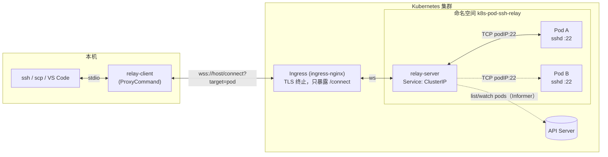
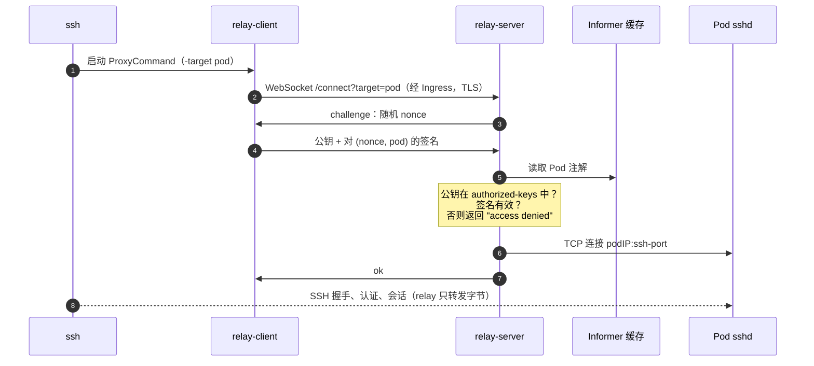

# k8s-pod-ssh-relay

[English](README.md) | 简体中文

通过 WebSocket relay 作为 ssh 的 `ProxyCommand`，登录运行原生 `sshd` 的 Kubernetes Pod。目标 Pod 不对集群外暴露任何 Service 或端口，也不需要 agent 或 sidecar。

```
ssh ──stdio──> relay-client ──wss──> Ingress (TLS) ──ws──> relay-server ──TCP──> <podIP>:22 (sshd)
```

## 特性

- **原生 ssh**：支持 `ssh`、`scp`、`sftp`、`rsync -e ssh`、VS Code Remote-SSH，以及端口转发（`-L` / `-R` / `-D`）。
- **按 Pod 名连接**：`ssh <pod-name>.relay`。relay 从 Pod Informer 本地缓存解析 Pod 名，每次连接都不需要请求 API Server。
- **注解开启**：只有带注解 `k8s-pod-ssh-relay/ssh: "true"` 的 Pod 才可以连接。
- **SSH 公钥认证，按 Pod 授权**：客户端必须证明自己持有目标 Pod 注解 `k8s-pod-ssh-relay/authorized-keys` 中列出的某个私钥。sshd 读取同一个注解，因此这个注解是 key 的唯一来源。修改后无需重启即可生效。
- **TLS**：在 ingress-nginx Ingress 终止（`wss://`），只暴露 `/connect`。

## 架构



`ssh` 与 `sshd` 之间端到端进行 SSH。relay 只负责认证客户端、选择 Pod、转发字节。

### 一次连接的过程



## 工作原理

1. `ssh` 把 `relay-client` 作为 `ProxyCommand` 启动，通过它的 stdin/stdout 收发 SSH 数据。
2. `relay-client` 经 Ingress 连接 `wss://<host>/connect?target=<pod>`。
3. **认证。** relay 下发 32 字节随机 nonce，客户端用私钥对 `(nonce, 目标 Pod 名)` 签名，relay 用目标 Pod 的 `authorized-keys` 注解校验签名。
   - nonce 防止重放；签名中包含 Pod 名，所以签名只对这个 Pod 有效。
   - Pod 不存在和 key 未授权，对客户端统一返回 `access denied`，防止探测哪些 Pod 存在。relay 日志会记录真实原因和公钥指纹。
4. relay 从 Informer 缓存查到 Pod IP，直连 Pod 的 sshd，之后双向转发字节。
5. SSH 在本地 `ssh` 与 Pod 内 `sshd` 之间端到端进行，所以 relay 只能看到加密后的 SSH 流量。

### Pod 注解

| 注解 | 必需 | 含义 |
|---|---|---|
| `k8s-pod-ssh-relay/ssh` | 是 | 必须为 `"true"`，Pod 才可以连接 |
| `k8s-pod-ssh-relay/authorized-keys` | 是 | 允许的公钥，`authorized_keys` 格式，每行一个 |
| `k8s-pod-ssh-relay/ssh-port` | 否 | sshd 端口（默认 `22`） |

示例 target 镜像就是普通的 Alpine + OpenSSH。sshd 通过 `AuthorizedKeysCommand` 从 downward API 卷读取 `authorized-keys`。不能用 `AuthorizedKeysFile`，因为 downward API 挂载目录的权限是 `1777`，sshd 的 `StrictModes` 检查会拒绝它。

## 快速开始（minikube）

依赖：minikube、kubectl、Go、OpenSSL。

```bash
minikube addons enable ingress
make all
```

`make all` 会依次：
- 编译二进制
- 在 minikube 内构建镜像
- 在 `keys/` 下生成 SSH key、自签 CA 和 TLS 证书
- 部署到 `k8s-pod-ssh-relay` 命名空间
- 生成 `ssh_config`

```bash
make pods                                # 查看 Pod 及其注解
make ssh                                 # 登录第一个 target Pod
ssh -F ssh_config <pod-name>.relay
scp -F ssh_config file <pod-name>.relay:/tmp/
```

生成的 `ssh_config` 匹配 `Host *.relay`，执行：

```
relay-client -relay wss://k8s-pod-ssh-relay.test -ca keys/ca.crt -connect-to <minikube-ip>:443 -i keys/id_ed25519 -target %h
```

如果不想每次加 `-F`，在 `~/.ssh/config` 开头加一行 `Include /path/to/ssh_config`。

### 在运行中的 Pod 上授权或撤销

```bash
kubectl -n k8s-pod-ssh-relay annotate --overwrite pod <pod> \
  k8s-pod-ssh-relay/authorized-keys="$(cat keys/id_ed25519.pub ~/.ssh/other.pub)"
```

- relay 通过 Informer 立即生效。
- sshd 要等 kubelet 同步 downward API 文件后才生效，最长约 1 分钟。

### 端口转发

端口转发是 SSH 连接内部的 channel，不需要 relay 做任何事：

```bash
ssh -F ssh_config -N -L 2224:kubernetes.default.svc:443 <pod-name>.relay  # 本机 2224 -> Pod 能访问的任意地址
ssh -F ssh_config -N -R 9000:127.0.0.1:3000 <pod-name>.relay              # Pod 内 127.0.0.1:9000 -> 本机 3000
ssh -F ssh_config -N -D 1080 <pod-name>.relay                             # 经 Pod 出口的 SOCKS5 代理
```

## relay-client 参数

| 参数 | 说明 |
|---|---|
| `-relay` | relay 地址，如 `wss://relay.example.com`（默认读取 `$RELAY_URL`） |
| `-target` | Pod 名。末尾的 `.relay` 会被去掉，所以可以直接传 `%h` |
| `-i` | 私钥（默认 `~/.ssh/id_ed25519`）。私钥有密码时使用 `ssh-agent` 中对应的 key，因为 ssh 占用了 stdin，客户端无法提示输入密码 |
| `-ca` | 额外信任的 PEM CA，例如自签的 Ingress 证书 |
| `-connect-to` | TCP 直连这个 `host:port`，不解析 URL 中的主机名。Host 头和 TLS 校验仍使用 URL 中的主机名，类似 curl 的 `--connect-to` |

如果 Ingress 域名有真实 DNS 记录，并且证书是公共受信任的，`-connect-to` 和 `-ca` 都可以省略。

## 安全说明

- 能修改该命名空间中 Pod 注解的人，就能给自己授予 SSH 权限。请用 RBAC 限制对 pods 的 `patch`，或者为 `k8s-pod-ssh-relay/*` 注解加 admission 策略。
- relay 只需要所在命名空间中 pods 的 `list`/`watch` 权限。
- 自带的 NetworkPolicy 只允许 relay 访问 target Pod 的 22 端口。只有支持 NetworkPolicy 的 CNI 才会执行它，例如 `minikube start --cni=calico`。
- demo 关闭了主机密钥校验（`StrictHostKeyChecking no`），因为 Pod 每次启动都会生成新的主机密钥。

## 目录结构

```
cmd/relay-client     ssh ProxyCommand
cmd/relay-server     relay（WebSocket -> Pod sshd）
internal/auth        SSH 公钥 challenge-response 认证
internal/k8s         Pod Informer、注解查询
internal/wsconn      WebSocket net.Conn 与双向转发
deploy/k8s.yaml      命名空间、RBAC、relay、Service、Ingress、target Pod、NetworkPolicy
Dockerfile.server    relay-server 镜像
Dockerfile.target    示例 target：Alpine + OpenSSH
```

## 许可证

[MIT](LICENSE)
